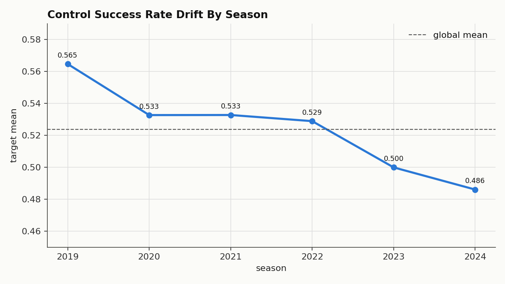
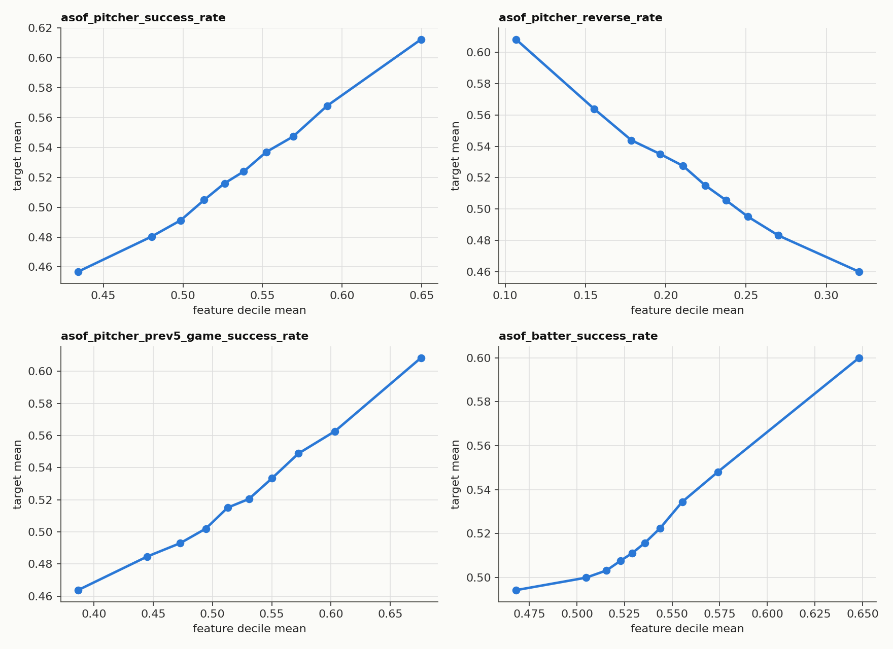
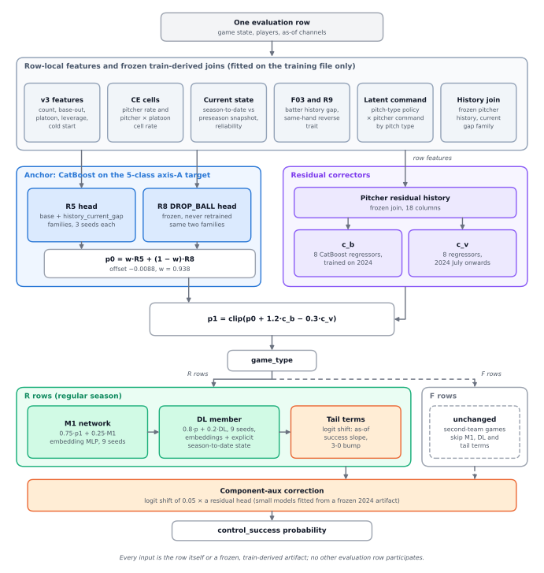

# Pitch Control Success Probability Prediction

Row-independent probability model for the **LG Aimers 9th online hackathon** on DACON
([competition 236743](https://dacon.io/competitions/official/236743/overview/description)):
given the state of a pitch before it is thrown, predict the probability that the pitcher achieves *control success*.
The score is a Brier skill score; the solution documented here finished **149th with a score of 1130.02432**.

> The competition data belongs to the organizers and is **not** part of this repository, and neither are model weights or
> frozen train-derived tables. This repository records the exploratory data analysis and the architecture of the final model.

## Highlights

* **Row independence by construction.** A submission is a code package that the organizers run on a hidden season of
  pitches. Every probability here is a function of its own row and of frozen tables fitted on the training data; no
  statistic is ever computed across evaluation rows. The contract is executable (`validation/row_independence_audit.py`):
  the largest difference between a row predicted alone and inside any batch is exactly 0 for the CatBoost graph and about
  1e-8 with float32 neural members.
* **The target is rebuilt, not just predicted.** Failure is a mixture of three different things (reversed, in the
  middle of the zone, a ball), so the anchor is trained on a reconstructed 5-class target and only the success class is used.
* **A residual corrector learns last season's error.** A CatBoost model learns, per pitcher, where the anchor was
  systematically wrong *last season* and applies that to the next, after the league-wide level has been removed.
* **Trees saturate; networks do not.** Two small neural members (an asymmetric M1 network and an embedding MLP with an
  explicit season-to-date state) fix a slope that CatBoost cannot extrapolate.

## Contents

* [Problem](#problem) · [What the data looks like](#what-the-data-looks-like) · [Pipeline](#pipeline)
* [Features](#features) · [Anchor](#anchor-r5-and-r8) · [Residual correctors](#residual-correctors) · [Neural members](#neural-members) · [Tail terms and component-aux](#tail-terms-and-component-aux)
* [Validation and rule compliance](#validation-and-rule-compliance) · [Repository structure](#repository-structure) · [Getting started](#getting-started)
* [Verification](#verification) · [Acknowledgements](#acknowledgements)

## Problem

Each row of `train.csv` (about 1.48M rows, 49 columns, seasons 2019 to 2024) is one pitch: game state (inning, count,
outs, runners, score, leverage index, win expectancy), pitcher / batter / team identifiers (anonymous), handedness, and
`asof_*` columns: running career statistics of the pitcher and batter *up to* that pitch, computed by the organizers
(success / reverse / middle / ball / strike rates, rates over the previous 1, 3 and 5 games, pitch-mix shares, sample
sizes). The label `control_success` is the organizers' outcome for the pitch. The hidden test set is the following season.

```text
Brier = mean((p - y)^2)      r = mean(y)      score = 100000 * (1 - Brier / (r * (1 - r)))
```

Three constraints shaped everything:

1. **Row independence.** The value for a row may not depend on any other evaluation row: no cumulative, rolling, group or
   frequency feature, no target encoding, no fitting or calibration on the test batch.
2. **No external data.** Only the official files; frozen artifacts must be fitted on them before inference starts.
3. **Code submission.** `script.py` and `model/` run offline on a fixed machine within ten minutes.

## What the data looks like

The architecture follows from four observations, all visible in aggregate plots (see [`eda/`](eda)):

<p>
  
  
</p>

1. **The base rate drifts** from 56.5% (2019) to 48.6% (2024), and not uniformly: some counts fall much further than
   others ([season x count map](docs/figures/target_by_season_and_count.png)). A model trained on pooled years is biased
   for the next one, so recency and level handling matter more than raw capacity.
2. **The as-of channels are monotone but shrunk.** Their deciles line up with the target, yet fitted models compress them
   towards the mean, and the slope grows from season to season.
3. **Two populations.** Regular-season (`R`) and second-team (`F`) games differ in level and in how they drift; most late
   components act on `R` rows only.
4. **Pitcher effects persist.** A pitcher's game-type-adjusted success rate in one season correlates roughly 0.5 to 0.7
   with the next season's (`eda/year_relationship_identity_continuity_audit_v1.py` measures this). The residual corrector
   below is built on that persistence: it learns, per pitcher, last season's error after the league-wide level is removed.

## Pipeline



The two CatBoost heads and the residual correctors act on every row; the neural members and the tail terms act on
regular-season (`R`) rows only; the component-aux correction acts on all rows. The diagram is also available as a
[PNG](docs/figures/architecture.png).

## Features

All features are row-local; anything that needs history is a join against a table frozen from the training file.

| Block | Module | What it contains |
| --- | --- | --- |
| v3 engineering | [`v3_features.py`](pitch_control/v3_features.py) | count state, base-out state, inning phase, platoon matchup, pressure and score states, cold-start state, short-vs-long as-of gaps, pitch-mix entropy, sample-size logs |
| CE cells | [`ce_features.py`](pitch_control/ce_features.py) | frozen pitcher rate and pitcher x platoon-cell rate, deviation and size |
| Current state | [`current_state_features.py`](pitch_control/current_state_features.py) | long-run rate vs current-season rate vs reliability (`n / (n + k)`) against a frozen preseason snapshot |
| F03 | [`f03_features.py`](pitch_control/f03_features.py) | batter history gap (8 features) from a frozen batter snapshot |
| R9 | [`r9_features.py`](pitch_control/r9_features.py) | same-hand reverse trait of the pitcher (5 features) |
| Latent pitch command | [`latent_command_features.py`](pitch_control/latent_command_features.py) | inferred pitch-type policy by hand / count / context, combined with the pitcher's command by pitch type: expected success and ball means, entropy, KL to the base policy |
| History artifacts | [`history_features.py`](pitch_control/history_features.py) | frozen pitcher history joined by identifier (the `hist_current_gap` family) |

## Anchor: R5 and R8

* **Target.** `control_success` is a mixture of three failure types, so the anchor is trained on five classes:
  `success`, `reverse_only`, `middle_only`, `reverse_and_middle`, `other_failure`. Only the class-0 probability is used.
  The classes are reconstructed **inside the training file** from the change of the official running as-of columns between
  consecutive rows of the same pitcher, which the organizers' Q&A allowed for training targets; the formula is never applied
  to evaluation rows.
* **Models.** CatBoost, 96 trees, depth 8, learning rate 0.055, `l2_leaf_reg` 7, two feature families (`v3_base` and
  `hist_current_gap`) x three seeds, averaged 50 : 50. Training weights favour recent seasons (0.65 in 2019 up to 1.30 in 2024).
* **R8 DROP_BALL.** The same structure without the ball-command block, frozen and never retrained; a low-weight
  complementary view. The R5 / R8 weights are 0.938 / 0.062.
* **Level.** An additive offset of -0.0088 (pooled out-of-fold mean residual of 2022 to 2024, capped at 0.02) removes the
  gross base-rate drift.

## Residual correctors

The anchor's error for a given pitcher persists into the next season, once the league level is removed. The corrector
(`R_CAND`, also called RC3) is trained on exactly that:

```text
residual = y - anchor_oof_2024              (anchor fitted on seasons < 2024, strict-forward)
target   = residual - mean(residual | game_type)        # level removed on purpose
features = 46 row features + 18 pitcher residual-history aggregates (frozen join, seasons < 2025 at inference)
c_b      = mean of 8 CatBoost regressors, all of 2024          c_v = same recipe, 2024 July onwards
final    = clip(p0 + 1.2 * c_b - 0.3 * c_v, 0, 1)              each seed's output capped at +-0.10
```

Removing the level is the decisive detail: mixing level into the target makes the correction fail in a year where the
level moves. `c_v` captures the late-2024 part of the pattern and enters with a negative sign. Compact versions of the
recipes are in [`training/reference/`](training/reference).

## Neural members

CatBoost's leaves saturate: a deviation feature outside the training range is not extrapolated, which leaves a systematic
residual slope. Two small networks fix that and are blended convexly on `R` rows only (`F` rows were worse offline):

* **M1** (`asym_m1_*`): categorical embeddings + a 256-128 MLP, with auxiliary heads for the failure components, 9 seeds,
  `0.75 * p + 0.25 * M1`.
* **DL member D4** (`dl_convex_predictor.py`): embeddings (16 dimensions for pitcher / batter, 4 for the rest) and a
  512-256-128 MLP over the official numeric columns plus an explicit **season-to-date state**: the row's own career as-of
  value minus a frozen, exactly reproducible through-last-season table gives the current-season rate, its sample size,
  its reliability and its deviation from the prior. Evaluated in float64 so it is batch-composition independent to ~1e-15.
  `0.8 * p + 0.2 * DL`, 9 seeds.

## Tail terms and component-aux

* **Tail terms** (`tail_terms.py`): on `R` rows, `logit(p') = logit(p) + sum_j gamma_j * x_j` with four terms:
  the as-of success rate minus 0.52 (one slope for cold-start pitchers, another for known ones), the deviation from the
  frozen preseason rate (known pitchers), and a bump for 3-0 counts. The slope of the as-of rate grows from season to
  season, which fitted models under-represent; the scales are fixed constants in the code.
* **Component-aux correction** (`component_aux_corr.py`): reconstructed component labels (`reverse`, `middle`, `ball`, `strike`) are
  used as auxiliary training signals. A frozen 2024 artifact (factor features, component labels, clipped residual targets)
  ships with the model; small scikit-learn histogram-boosting models are fitted from it **inside inference** and shift the
  logit by `0.05 x` a residual prediction. The fit depends only on the frozen artifact, never on the rows being scored,
  which `tests/test_component_aux.py` checks.

## Validation and rule compliance

* **Strict-forward folds** (2021 to 2024): anything fitted for a validation year uses seasons strictly before it, and
  frozen tables are joined per row with that row's own season cut-off. 2023 is treated as a regime-shift diagnostic, not as
  a proxy for 2025.
* **Row-independence audit** before any package was built: one row vs the batch, several chunk sizes, shuffled order,
  duplicated rows, every field of unrelated rows scrambled, repeated calls, plus a static inspection of the dependency graph.
* The final code contains fixed constants and row-local logic only.

## Repository structure

```text
.
├── pitch_control/      row-independent inference graph of the submitted solution
├── eda/                exploratory scripts (profiles, drift, information audit) and the first week's phase0 units
├── training/           compact fitting recipes for the anchor and the corrector
├── validation/         the row-independence audit
├── tests/              synthetic-data tests (no competition data needed)
└── docs/               aggregate EDA figures and the architecture diagram
```

<details>
<summary>Code map</summary>

| Path | Role |
| --- | --- |
| `pitch_control/predictor.py` | `Predictor`: feature graph, CatBoost heads, corrector, M1, DL member, tail terms, component-aux |
| `pitch_control/tail_terms.py` | row-local logit terms (moved verbatim from the submitted script) |
| `pitch_control/asym_m1_*.py`, `dl_convex_predictor.py` | the two neural members and their frozen-table features |
| `pitch_control/r_cand_features.py` | corrector inference: pitcher residual-history join, capped CatBoost regressors |
| `pitch_control/component_aux_corr.py` | component-aux correction fitted from a frozen artifact |
| `pitch_control/__main__.py` | `python -m pitch_control --model-dir model --data-dir data --output-dir output` |
| `training/reference/*.py` | the anchor and corrector recipes in about 60 lines each |
| `validation/row_independence_audit.py` | generic audit for any `predict(frame)` function |
| `eda/*.py`, `eda/phase0/` | EDA scripts (see [`eda/README.md`](eda/README.md)) |
| `docs/make_architecture_figure.py` | redraws the architecture diagram (SVG and PNG, needs matplotlib) |

</details>

## Getting started

Tests need no competition data; they run on synthetic frames that only mimic the schema.

```bash
python -m venv .venv && source .venv/bin/activate
pip install -r requirements-dev.txt
pytest -q                      # torch-dependent tests skip themselves if torch is missing
```

With the competition files in `data/` the EDA scripts run from the project root (`pip install -r requirements-eda.txt`), for
example `python eda/from_scratch_eda_v1.py`. Inference additionally needs the frozen artifacts, which are not distributed:

```bash
python -m pitch_control --model-dir model --data-dir data --output-dir output
python -m validation.row_independence_audit --model-dir model --frame pseudo_test.csv --rows 2000
```

## Verification

* Every module in `pitch_control/` is **AST-identical** to the corresponding file of the submitted package apart from
  relative imports and docstrings. `config.py` keeps only the column groups the feature graph uses; the tail-term helpers
  and the `Predictor` class were moved out of the submitted `script.py` verbatim (checked with the same AST comparison).
* `pytest` covers the feature graph, tail terms, reference recipes, component-aux, the audit tool and (when torch is
  installed) the neural members: 44 tests on synthetic data.
* The code that fitted the frozen artifacts is not part of this repository, and the EDA units under `eda/phase0/` are the
  scripts as they were run; neither was re-run for this repository.

## Acknowledgements

Thanks to LG AI Research and DACON for the competition and the data. The dataset and the organizers' materials are not
redistributed here. The code is released under the [MIT License](LICENSE).
